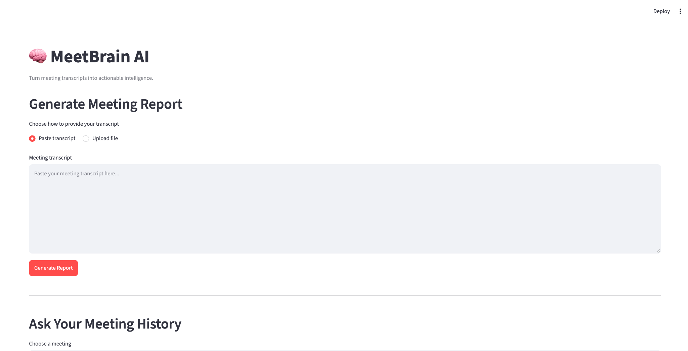
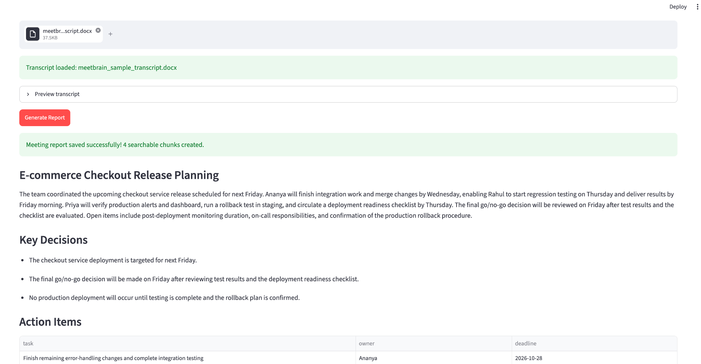
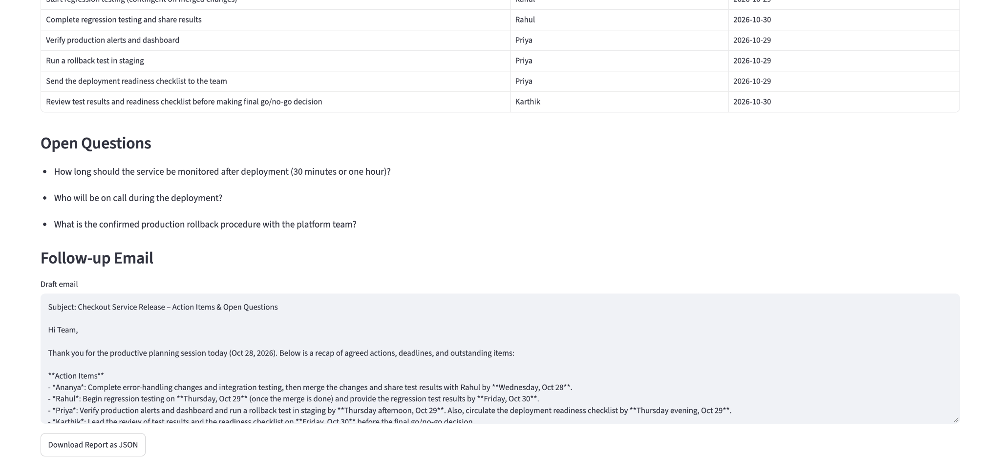
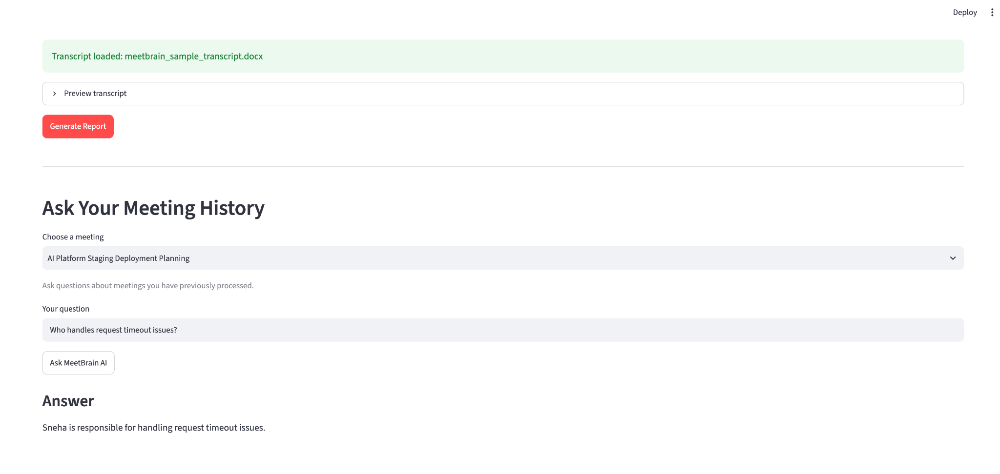

# MeetBrain AI

An AI-powered meeting intelligence assistant that converts meeting transcripts into structured reports and answers questions using Retrieval-Augmented Generation (RAG).


## Features
- Generate meeting summaries, key decisions, action items, and open questions.
- Validate structured reports using Pydantic.
- Orchestrate workflows using LangGraph.
- Store meeting reports and searchable chunks in ChromaDB.
- Generate embeddings using Sentence Transformers.
- Ask natural-language questions about individual meetings.
- Upload TXT, PDF, and DOCX transcripts.
- Run automated tests using pytest.

## Tech Stack
- Python, Streamlit, Groq API
- LangGraph, ChromaDB, Sentence Transformers
- Pydantic, Pytest

## Architecture
1. Streamlit accepts transcript text or uploaded documents.
2. Groq generates a structured meeting report.
3. Pydantic validates the report.
4. LangGraph orchestrates report generation and validation.
5. ChromaDB stores reports and section-level chunks.
6. Sentence Transformers generates embeddings for semantic retrieval.
7. Retrieved meeting context is passed to the LLM for question answering.

## Setup
```bash
git clone https://github.com/shanmukh-pallapu7/meetbrain-ai.git
cd meetbrain-ai
python -m venv .venv
source .venv/bin/activate
pip install -r requirements.txt
```

Create a `.env` file:
```env
GROQ_API_KEY=your_groq_api_key_here
```

## Run
```bash
streamlit run app.py
```

## Tests
```bash
pytest -q
```
Latest test result: 21 passed.

## Limitations
- Scanned PDFs requiring OCR are not supported yet.
- Meeting data is stored in a local ChromaDB database.
- Retrieval quality depends on transcript quality and the embedding model.

## Future Improvements
- OCR support for scanned documents.
- Cloud deployment and authentication.
- Expanded retrieval and answer evaluation.


## Application Screenshots

### MeetBrain AI dashboard


### Generated meeting report


### Action items and open questions


### Meeting-specific RAG question answering
