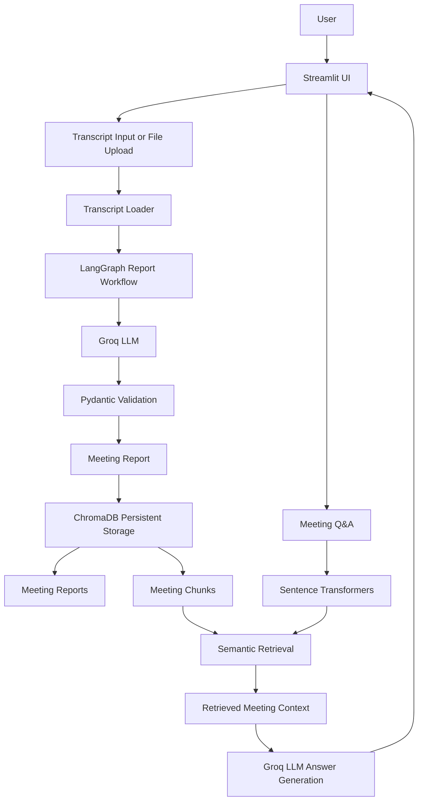

# MeetBrain AI

**An AI-powered meeting intelligence assistant that turns meeting transcripts into structured reports, searchable meeting memory, and context-grounded answers.**

MeetBrain AI helps users extract important outcomes from meetings. It generates summaries, decisions, action items, and open questions, then stores meeting content so users can ask follow-up questions in natural language.

## Features

- **Transcript ingestion:** Paste a transcript or upload a `.txt`, `.pdf`, or `.docx` file.
- **Structured meeting reports:** Generate a title, summary, decisions, action items, and open questions.
- **Schema validation:** Validate the structure of LLM-generated reports with Pydantic.
- **Workflow orchestration:** Organize report-generation and validation steps with LangGraph.
- **Meeting memory:** Persist meeting reports and searchable transcript sections in ChromaDB.
- **Semantic search and Q&A:** Retrieve relevant meeting chunks using Sentence Transformers embeddings and answer questions using retrieved context.
- **Meeting-specific retrieval:** Scope Q&A to the selected meeting to reduce cross-meeting information leakage.
- **Follow-up content:** Generate a follow-up email from the meeting report.

## Architecture



### Main flows

**1. Report generation**

1. The user provides a transcript through the Streamlit interface.
2. The transcript loader extracts text from supported file formats.
3. LangGraph coordinates report generation and validation.
4. The Groq model generates a structured report.
5. Pydantic validates the generated report.
6. The report and its searchable sections are persisted in ChromaDB.

**2. Meeting Q&A (RAG)**

1. The user asks a question about a selected meeting.
2. Sentence Transformers converts the question into an embedding.
3. ChromaDB retrieves semantically relevant meeting chunks.
4. Retrieved text is supplied to the LLM as context.
5. The LLM generates an answer grounded in the retrieved meeting content.

## Technology Stack

| Area | Technology |
|---|---|
| User interface | Streamlit |
| Programming language | Python |
| LLM provider | Groq API |
| Workflow orchestration | LangGraph |
| Data validation | Pydantic |
| Vector database | ChromaDB |
| Embedding model | `sentence-transformers/all-MiniLM-L6-v2` |
| Document parsing | pypdf, python-docx |
| Testing | pytest |

## Project Structure

```text
meetbrain-ai/
├── app.py
├── llm_service.py
├── schemas.py
├── meeting_service.py
├── meeting_graph.py
├── meeting_store.py
├── meeting_qa.py
├── transcript_loader.py
├── evaluation_set.py
├── evaluate_retrieval.py
├── evaluate_answers.py
├── compare_retrieval.py
├── requirements.txt
├── .env.example
├── README.md
└── tests/
```

*This is the expected high-level structure; adjust it if your local repository differs.*

## Getting Started

### Prerequisites

- Python 3.11 or later recommended
- A Groq API key

### 1. Clone the repository

```bash
git clone https://github.com/shanmukh-pallapu7/meetbrain-ai.git
cd meetbrain-ai
```

### 2. Create and activate a virtual environment

macOS / Linux:

```bash
python3 -m venv .venv
source .venv/bin/activate
```

Windows:

```bash
python -m venv .venv
.venv\Scripts\activate
```

### 3. Install dependencies

```bash
python -m pip install --upgrade pip
pip install -r requirements.txt
```

### 4. Configure environment variables

```bash
cp .env.example .env
```

Add your Groq API key to `.env`:

```env
GROQ_API_KEY=your_groq_api_key_here
```

**Important:** Never commit your `.env` file or expose your API key. Commit only `.env.example` with a placeholder.

### 5. Run the application

```bash
streamlit run app.py
```

Open the local URL printed in your terminal.

## Running Tests

```bash
pytest -q
```

## Design Decisions

- **LangGraph:** Makes report-generation and validation stages explicit and provides a foundation for conditional paths or retries. A simple sequential Python function could also handle a strictly linear workflow.
- **ChromaDB:** Supports semantic retrieval over meeting text, useful when users phrase questions differently from the transcript. A relational database can complement it for structured application data.
- **Sentence Transformers:** Creates vector representations of meeting chunks and user questions so semantically related content can be retrieved.
- **Meeting metadata filters:** Restrict retrieval to the selected meeting, helping prevent answers from mixing information across meetings.
- **Pydantic:** Checks the structure and types of generated report data. It does not, by itself, prove that the report's claims are factually correct.

## Current Limitations

- Answer quality depends on transcript quality and retrieved context.
- Retrieval and prompt instructions reduce unsupported answers but cannot guarantee hallucinations never occur.
- Scanned PDFs containing images rather than selectable text may require OCR.
- The application uses a Groq-hosted model, so transcript content sent for inference is processed by the configured external provider.
- Authentication, multi-user access control, and production deployment hardening are not yet presented as completed features.

## Future Improvements

- Add OCR support for scanned meeting documents.
- Add answer evaluation and retrieval-quality reporting.
- Add source references to answers so users can trace responses to meeting sections.
- Add authentication and role-based access controls.
- Add production deployment, monitoring, and structured application logging.

## Screenshots

Place your application screenshots in a `screenshots/` folder in the repository. Then add them to this section:

```markdown


```

## Author

Built as a hands-on AI engineering project to explore LLM integration, structured generation, workflow orchestration, embeddings, vector search, and retrieval-augmented generation.

**Repository:** https://github.com/shanmukh-pallapu7/meetbrain-ai
